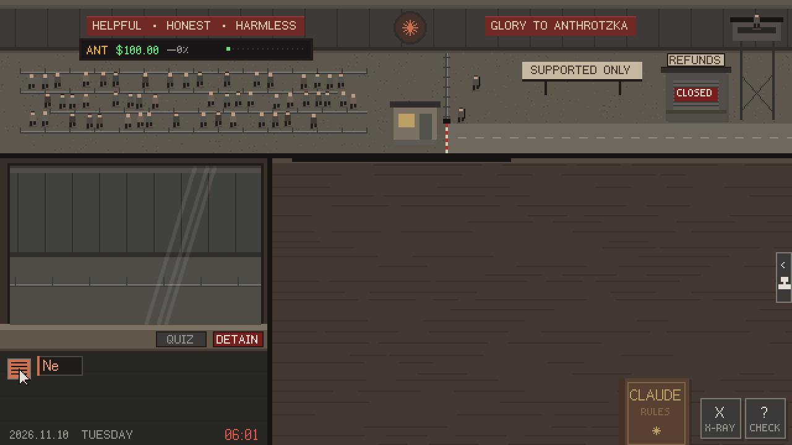

<p align="center">
  <a href="https://ipo-please.github.io"></a>
</p>

<h1 align="center">IPO, PLEASE</h1>

<p align="center">
  <a href="README.md">简体中文</a> · <b>English</b>
</p>

<p align="center">
  The sequel to <i>IP, PLEASE</i>, a Papers, Please–style pixel game.<br>
  Anthrotzka went public, and every ban is now revenue. You're still inspector Claude at the UTC+8 Border Checkpoint: every old rule still applies, and there's a new one each day.
</p>

<p align="center">
  <a href="https://ipo-please.github.io"><b>▶ Play in your browser: ipo-please.github.io</b></a><br>
  <sub>Pick <b>English</b> on the first screen.</sub><br>
  New here? Play the first game, <a href="https://ip-please.github.io/">IP, PLEASE</a>, first (<a href="https://github.com/ip-please/ip-please.github.io">repo</a>) · <a href="https://space.bilibili.com/3707008398134122">Bilibili</a>
</p>

<p align="center">
  
  <br>
  <sub>Day 2: “Payment first, please.”</sub>
</p>

- 5 days of story plus an ending, about 25 minutes, auto-saves after each day; same story as the Bilibili video
- 中文 / English: pick a language on the first screen (it also peeks at your device's timezone for a joke, locally only)
- Drag papers with your finger on a phone in landscape, or with the mouse on a computer
- A plain static web page that loads nothing from outside; download the repo and double-click `index.html` to play offline
- The bottom-right corner of the title screen links to the first game, GitHub and Bilibili (the credits keep just GitHub and Bilibili); the first game links back here
- Preview: add `#end` to the URL to jump to the credits, or `#title` for the title screen

## In English

- **Chinese that gives people away stays in Chinese**: “Hello, I am 美国人。”, verbal tics, quiz answers, fast-lane lines. The inspection banner explains in English what doesn't add up.
- **Quiz lines show the original plus a literal translation.** Every mainland Chinese traveler finishes the line on reflex; business travelers and real Americans just look confused.
- **Each day's newspaper has a Translator's Note** explaining the memes: America (UTC+8), VPN “ladders”, “run” (润), 996, and more.

## How to play

Call the next traveler → drag their papers onto the desk → check them against the Constitution → stamp → hand the papers back. As in the first game, in CHECK mode you click two fields that contradict each other, or click something the traveler said. There are a lot of rules now, so clicking just the wrong field also raises a warning (no need to click the Constitution article too). Lines where someone abuses Claude can be clicked as well.

| Day | Date | New rules / tools |
|---|---|---|
| 1 | 11.09 | Chinese window, UnionPay lane (Constitution pages 1–2 are the same as the first game; fail the quiz → DETAIN) |
| 2 | 11.10 | Anthrotzka IPO: travelers pay first, then get inspected. Denying someone who paid = revenue confirmed (7% cut). Abusing Claude → DETAIN |
| 3 | 11.11 | GPS location (IP still checked) |
| 4 | 11.12 | New Constitution: §8 headquarters · §9 shareholders · §10 AIs may not be detained · §11 ban list (earlier bans count); company lookup |
| 5 | 11.13 | New accounts: banned travelers come back in disguise |

## Files

| Path | What's inside |
|---|---|
| `index.html` | The page |
| `main.js` | Scene switching, input, main loop |
| `booth.js` | The booth: papers, stamps, CHECK mode, quiz, detain, payment, GPS, company lookup, ban list |
| `world.js` | Top half of the screen: ANT ticker, refund queue, phones and fish in the line, the silk banner, the final crash |
| `events.js` | Fast lanes, fish swarm, usage limit, the author (§13), George's Chinese chat, ending |
| `screens.js` | Boot, intro, title, newspaper, end-of-day summary, credits, save, links in the corner |
| `data.js` | The script: each day's travelers, newspapers, random travelers, abuse pool, quiz lines |
| `docs.js` | Documents: passport, cards, receipts, good-morning card, silk banner, Constitution |
| `gfx.js` / `sfx.js` | Pixel drawing / sound synthesis (all generated live, no audio files) |
| `i18n.js` | Language: the language-select screen and `T()` lookups; in English mode `gfx.js` translates text before drawing it |
| `en.js` | English translations (keyed by the original Chinese), Chinese kept as-is (the giveaways), daily Translator's Notes |
| `assets.js` | Pre-rendered characters, backgrounds and glyph atlas (generated by `tools/build_assets.py`; don't edit by hand) |
| `tools/` | `pp/` draws characters and scenes (shared with the video), `build_assets.py` builds assets (English signs, stamps and newspaper art get `:en` variants), `playtest.js` plays the whole game automatically, `check_en.js` finds missing translations, `audit_en.js` finds English text that overflows, `record_gif.js` + `make_media.py` build `media/` |
| `media/` | Logo and gameplay GIFs for the README, link preview card `og.png` |

## Editing and rebuilding assets

After changing in-game text (new Chinese characters must go into the glyph atlas) or how characters are drawn, regenerate `assets.js`:

```bash
pip install -r tools/requirements.txt
python tools/build_assets.py
```

If you change a Chinese line, update the matching key in `en.js` too (it must match the Chinese exactly). To list anything missing:

```bash
node tools/check_en.js
```

Local preview: run `python3 -m http.server 8952` in the repo root and open <http://localhost:8952>.

## Automated playtest

A virtual clock plus real mouse events play from boot to the credits and screenshot the key moments:

```bash
python3 -m http.server 8952 --bind 127.0.0.1 &
PW_CORE=<path to playwright-core> node tools/playtest.js <screenshot dir>
```

`LANG_PICK=en` plays in English; `DAYS=2` plays only the first two days; `SEED=777` draws a different set of random travelers; `MISTAKES=d1-1-JOHN,jorji-deny` gets a few travelers wrong on purpose, to see citations and the other branch.

## Credits and license

- A tribute to Lucas Pope's *Papers, Please*. This is a fan-made satire and every character is fictional. It mocks blocking by region and by shareholding, and the absurd disguises around it, not any ethnicity or group.
- All art, music and sound effects are generated by code written with Claude Code.
- Code released under the [MIT](LICENSE) license.
- Pixel font: [Fusion Pixel Font](https://github.com/TakWolf/fusion-pixel-font), SIL Open Font License 1.1 (see `OFL-fusion-pixel.txt`).
