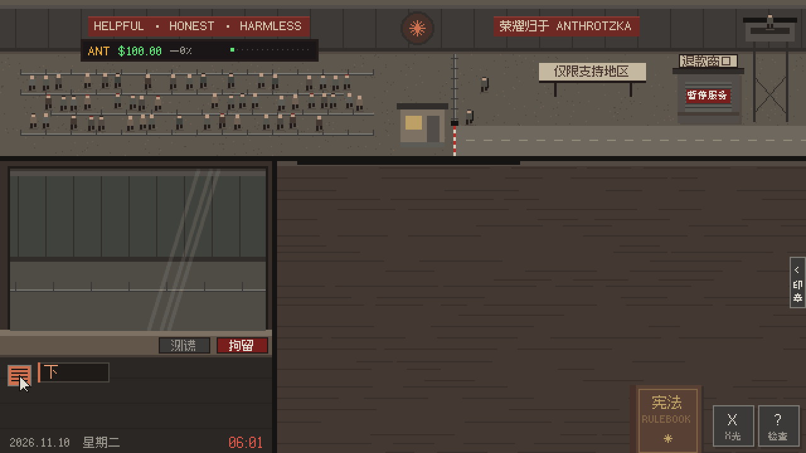

<p align="center">
  <a href="https://ipo-please.github.io"></a>
</p>

<h1 align="center">IPO, PLEASE · 请出示资金证明</h1>

<p align="center">
  <b>简体中文</b> · <a href="README.en.md">English</a>
</p>

<p align="center">
  《IP, PLEASE》的续作，Papers, Please 画风的像素小游戏。<br>
  安索兹卡上市了，封号即营收。你还是东八区检查站的审查员 Claude：旧规一条不少，新规每天加一条。
</p>

<p align="center">
  <a href="https://ipo-please.github.io"><b>▶ 在线玩：ipo-please.github.io</b></a><br>
  没玩过前作的，先玩 <a href="https://ip-please.github.io/">《IP, PLEASE》</a>（<a href="https://github.com/ip-please/ip-please.github.io">仓库</a>）· <a href="https://space.bilibili.com/3707008398134122">B 站主页</a>
</p>

<p align="center">
  
  <br>
  <sub>Day 2：“请先付款。”</sub>
</p>

- 5 天剧情 + 结局，全程约 25 分钟，每天下班自动存档；剧情和 B 站同名视频一致
- 中文 / English：开机画面选语言（同前作，选的时候会看一眼你设备的时区开个玩笑）
- 手机横屏用手指、电脑用鼠标拖证件
- 纯静态网页，不加载任何外部资源，下载后直接双击 `index.html` 也能玩
- 标题页右下角是前作、GitHub、B 站的传送门（片尾只留 GitHub 和 B 站）；前作的标题页和片尾也指回这里
- 预览：网址后面加 `#end` 直接看片尾，`#title` 直接看标题页

## 运行

```bash
python3 -m http.server 8952      # 仓库根目录，然后打开 http://localhost:8952
```

## 玩法

叫号 → 把证件拖到桌上 → 对照《宪法》检查 → 盖章 → 把证件还给旅客。和原作一样，检查模式里点两处信息找矛盾，或者点旅客说的话找马脚；规则太多，出错的那一栏单点也能出警告（不用再点宪法条款）。虐待 Claude 的那句话也能点。

| 天 | 日期 | 新规 / 新工具 | 固定角色 |
|---|---|---|---|
| 1 | 11.09 | 中文窗口、银联通道（宪法第 1–2 页和原作一样；测谎露馅按『拘留』） | 老面孔快剪、John、港仔、新加坡同胞快剪、锦旗大叔、爷爷的早安图、乔治（银联） |
| 2 | 11.10 | 安索兹卡上市：先付款再检查，拒绝已付款的旅客 = 收入已确认（分成 7%）；不得虐待 Claude → 拘留 | Max 哥、苹果哥（强制退款）、John（芜湖～起飞）、闲鱼尼日利亚人、暴躁老哥、凌晨五点、中转站、乔治（梯子断了） |
| 3 | 11.11 | GPS 定位（IP 照查） | 三年拼车、蒸馏大肥鱼、鱼灾、Mike（人在陆家嘴）、福报老板、乔治（花呗代充） |
| 4 | 11.12 | 新版宪法：§8 总部 · §9 股东 · §10 AI 不得拘留 · §11 封号清单（以前封的也算）；企查 | 大肥鱼（你不能拘留我了）、John（两万亿）、东京润哥、德州人、戴眼罩的乔治 |
| 5 | 11.13 | 换号：被封的人伪装回来 | 套头套的鲸鱼娘、乔治终版、作者（§13）、结局 |

## 目录

| 路径 | 内容 |
|---|---|
| `index.html` | 页面 |
| `main.js` | 场景切换、输入、主循环 |
| `booth.js` | 检查亭：证件、盖章、检查模式、测谎、拘留、付款、GPS、企查、封号清单 |
| `world.js` | 上半屏：ANT 股价屏、退款窗口的队伍、排队区的手机和鱼、锦旗、结局崩盘 |
| `events.js` | 快剪、鱼灾、额度用完、作者 §13、乔治的中文聊天、结局 |
| `screens.js` | 开机、开场、标题、报纸、下班结算、片尾、存档 |
| `data.js` | 剧本：每天的旅客、报纸、随机路人、虐待词池、测谎题 |
| `docs.js` | 证件：护照、各种卡、小票、早安图、锦旗、宪法 |
| `gfx.js` / `sfx.js` | 像素绘图 / 音效合成（全部现场合成，没有音频文件） |
| `i18n.js` | 语言：选语言画面、T() 查表；英文模式下 gfx.js 画字前自动查表 |
| `en.js` | 英文译文（键是中文原句）、原样保留的中文（露馅的那句）、每天报纸的译注 |
| `assets.js` | 预渲染的人物、背景、字形图集（由 `tools/build_assets.py` 生成，不要手改） |
| `tools/` | `pp/` 是像素画法（和视频共用），`build_assets.py` 生成素材（英文版的招牌、印章、报纸配图另出 `:en`），`playtest.js` 自动试玩，`check_en.js` 查英文缺哪些译文，`audit_en.js` 查英文界面有没有字出界，`record_gif.js` + `make_media.py` 生成 `media/` |
| `media/` | README 用的 logo、游戏动图，以及链接分享卡片 `og.png` |

## 英文版

做法同原作：中文是原文，`en.js` 以中文原句为键。

- 改了中文台词，要同步改 `en.js` 的键；`node tools/check_en.js` 列出缺的译文和拼接出来的中文（拼接的改成 `T('…{0}…', x)`）。
- 露馅的中文（“Hello, I am 美国人。”、口癖、测谎题、快剪台词）英文版原样保留或附英文直译，检查横幅用英文解释；中国梗在每天报纸的 TRANSLATOR'S NOTE 里解释。
- 英文模式下 `txt` / `tw` / `bigText` / `wrap` 自动查表；已经翻好的显示文字（对白框、聊天里打字的半句）用 `rawTxt` / `rawTw`，不再查表。

## 修改与重建素材

改了游戏里的文字（新出现的汉字要进字形图集）或者人物画法之后：

```bash
.venv/bin/python tools/build_assets.py
```

人物画法在 `tools/pp/`（和视频共用一套），新角色的定义在 `tools/pp/cast2.py`。

## 自动试玩

虚拟时钟 + 真实鼠标事件，从开机一路玩到片尾，关键画面截图：

```bash
python3 -m http.server 8952 --bind 127.0.0.1 &
PW_CORE=<playwright-core 路径> node tools/playtest.js <截图目录>
```

`LANG_PICK=en` 玩英文版；`DAYS=2` 只玩前两天；`SEED=777` 换一批随机路人；`MISTAKES=d1-1-JOHN,jorji-deny` 故意判错几个人，看警告单和另一条分支。

## README 动图

```bash
LANG_PICK=zh PW_CORE=<playwright-core 路径> node tools/record_gif.js /tmp/gif-zh
LANG_PICK=en PW_CORE=<playwright-core 路径> node tools/record_gif.js /tmp/gif-en
.venv/bin/python tools/make_media.py /tmp/gif-zh /tmp/gif-en      # → media/
```

## 致谢与许可

- 致敬 Lucas Pope 的《Papers, Please》。本作是同人讽刺小品，角色均为虚构，讽刺的是“按地区、按股权封锁”这件事和各种伪装的荒诞，不针对任何民族和群体。
- 画面、音乐、音效均由 Claude Code 写程序生成。
- 代码以 [MIT](LICENSE) 许可开源。
- 像素字体：[缝合像素字体 Fusion Pixel Font](https://github.com/TakWolf/fusion-pixel-font)，SIL Open Font License 1.1（见 `OFL-fusion-pixel.txt`）。
